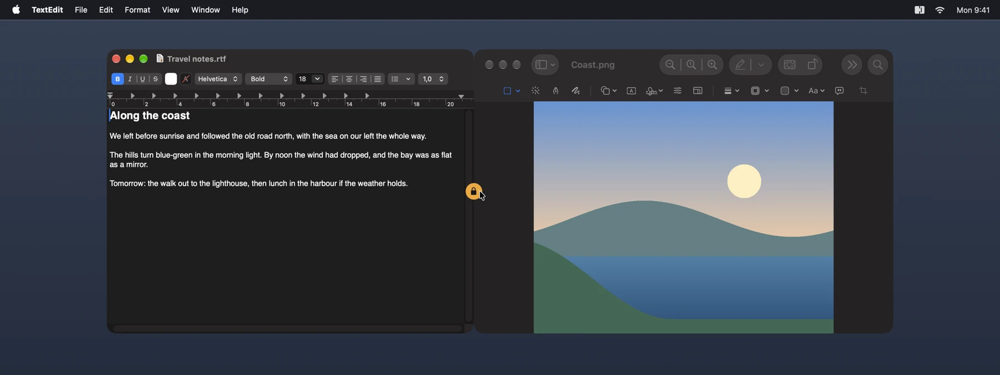
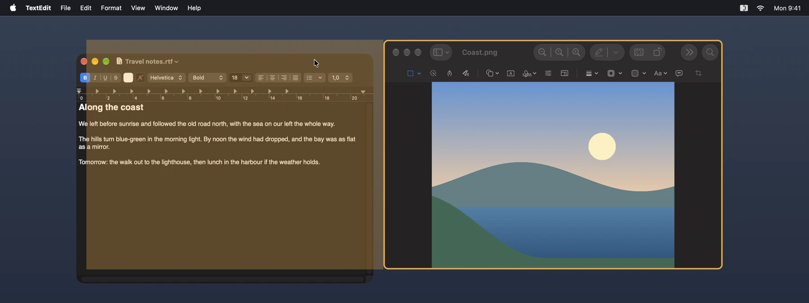
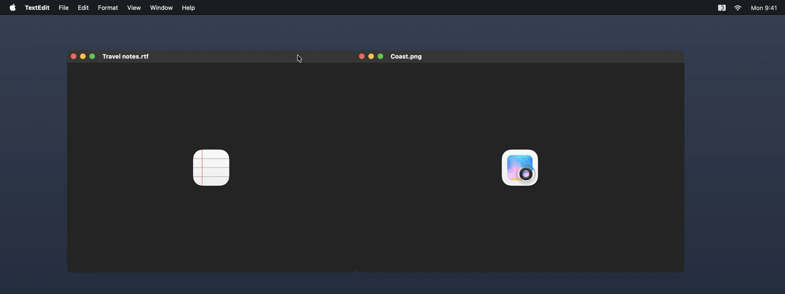
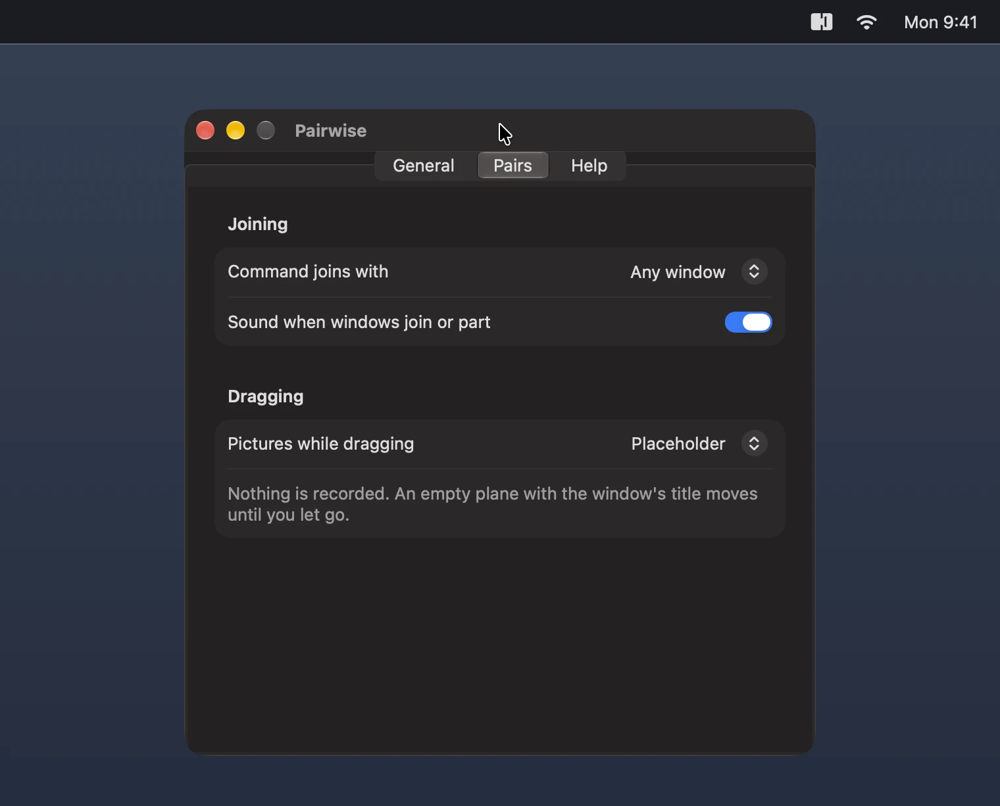

**Snap groups for your Mac.**

Bring two windows of any app together and they join: they move together, share their seam, come to the front together and come apart again easily. Pairwise works with the apps you already have, and needs nothing from them.



- **Join:** drag a window to another and press Command, or click the open lock on the seam of two windows side by side. Add Shift for the same height.
- **Move together:** drag either window of a pair.
- **Share the seam:** drag the edge between them to resize both.
- **Come apart:** click the closed lock on the seam, or press Command while dragging one of them.
- **Pairs that last:** a pair comes back after a quit and a restart of your Mac.
- **English, Dutch and German,** following your system language.



While you drag with Command pressed, a guide shows where the window will join.

> Pairwise is in beta (version 0.x).

## Install

### With Homebrew

```sh
brew install --cask mag243/tap/pairwise
```

### By download

1. Open [**the latest release**](https://github.com/mag243/pairwise/releases/latest) and download the `.dmg` file.
2. Open it and drag **Pairwise** onto **Applications**.
3. Start Pairwise from Applications. It is signed and notarized by Apple, so it opens without a warning.

Started from anywhere else, Pairwise offers once to move itself into Applications, where it can keep itself up to date.

## Permissions

Pairwise lives in the menu bar and needs one permission in System Settings: **Accessibility,** to move and resize the windows you join.

## What you see while dragging

Moving the real windows lags visibly behind the pointer, so while you drag a pair you see something else in their place. You choose what:



- **Placeholder** is what Pairwise starts with: an empty plane with the window's icon and title. Nothing is recorded, and Pairwise does not even ask for Screen Recording.
- **Still** shows one picture of the two windows when you start dragging. Video stands still during the drag, and the seam can look stretched.
- **Live** keeps video playing and the seam sharp. macOS then shows its purple recording icon during the drag, as it does for every app that captures a window continuously.



Still and Live take the Screen Recording permission, which Pairwise asks for when you choose one. They capture only the two windows of a pair, and only from the moment you press one of them or their seam until you let go. The pictures stay in memory, and are not saved or sent anywhere. Pairwise is open source, so you can [check this in the code](https://github.com/mag243/pairwise/tree/main/Packages/PairwiseKit/Sources/PairwiseWindowSystem).

## Updates

Pairwise checks for a new version once a day and asks before it installs one. You can check by hand with **Check for Updates…** in its menu, and turn the daily check off in its settings.

Every update is signed twice, by Apple's Developer ID and by Pairwise's own update key, and is installed only when both check out. Checking for updates asks GitHub for the update feed, which sends no more than any web request does.

## Requirements

- macOS 15 Sequoia or later
- A Mac with Apple silicon or an Intel processor

## Uninstall

Quit Pairwise and drag it from Applications to the Trash. With Homebrew, `brew uninstall --zap --cask pairwise` also removes its settings. macOS keeps the permissions under Privacy & Security in System Settings, where you can remove them.

## Feedback and source

Found a bug? [Open an issue](https://github.com/mag243/pairwise/issues). The source is [on GitHub](https://github.com/mag243/pairwise), under the MIT license.
